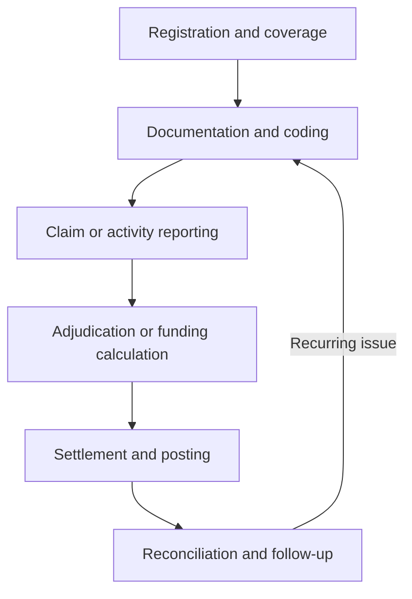

# Revenue cycle and glossary

A hospital needs to know who funds the encounter, what the applicable arrangement pays, what evidence supports payment, and whether the amount was received and posted correctly.

| Term | What it means and how it is used |
| --- | --- |
| Eligibility | Whether the patient is enrolled or qualifies under the program. Check the relevant service date. Coverage for a specific service can require additional checks. |
| Prior authorization | Advance review or approval for an in-scope service. Link the authorization to the encounter and verify its scope before billing. |
| Charge capture | Recording billable services, supplies, or other relevant activity from the encounter. Reconcile source events to the billing record. |
| Clinical coding | Translating documented diagnoses and procedures into the applicable classification. Preserve the code-set and grouper version. |
| Claim scrubber | Validates a proposed claim against deterministic rules and routes exceptions to staff. |
| NCCI | CMS National Correct Coding Initiative. In applicable Medicare settings, procedure-to-procedure edits check code combinations and medically unlikely edits check service units. |
| 837 | U.S. X12 electronic claim transaction. Track its originating claim revision and submission identifiers. |
| 999 | U.S. X12 implementation acknowledgment. Record the result against the transmitted transaction set. |
| 277CA | U.S. X12 claim acknowledgment. Capture claim-level acceptance or rejection and the responding organization. |
| 835 | U.S. X12 electronic remittance. Extract claim payments, adjustments, and other applicable details for reconciliation. |
| Clearinghouse | Intermediary that may translate, validate, and route electronic transactions. Distinguish its receipt from downstream payer acceptance. |
| Rejection | Failure at intake or validation. Determine the scope and confirm what was accepted before resubmitting. |
| Denial | Adjudication decision under which payment is denied for a claim or service. Review the reason and applicable correction or appeal process. |
| Contractual allowance | Adjustment that reflects the gap between charges and the amount recognized under applicable contract terms. |
| Patient responsibility | Amount assigned to the patient under applicable benefit and billing rules. Reconcile the assignment before billing. |
| Underpayment | Verified shortfall between expected and actual payer payment after applicable adjustments. |
| Payment posting | Application of a payment or adjustment to the billing and accounting records. Reconcile remittance, deposit, and posting. |
| A/R aging | Unresolved receivables grouped by age using a defined start event and reporting date. |
| Fee-for-service | Payment per eligible item or service. Reconcile units, prices and adjustments. |
| Case-based payment | Payment per eligible episode or group, potentially adjusted for case mix and exceptions. |
| Capitation | Payment per enrolled person for a defined scope and period. Reconcile attribution and risk adjustments where applicable. |
| Global or block budget | Funding determined for a service, provider, or period under the applicable arrangement. Compare budgets, adjustments and activity separately. |
| Activity-based funding | Funding linked to the volume and mix of services. Verify the unit, classification and price model. |

The U.S. transaction entries are scoped to X12. Compare local payment mechanisms in the [regional profiles](regions.md). Sources include the [Medicare Claims Processing Manual, Chapter 24](https://www.cms.gov/regulations-and-guidance/guidance/manuals/downloads/clm104c24.pdf), [CMS NCCI FAQ](https://www.cms.gov/medicare/coding-billing/national-correct-coding-initiative-ncci-edits/medicare-ncci-faq-library), and [WHO European Observatory on payment mechanisms](https://eurohealthobservatory.who.int/themes/health-system-functions/financing-and-payment/payment-mechanisms).

